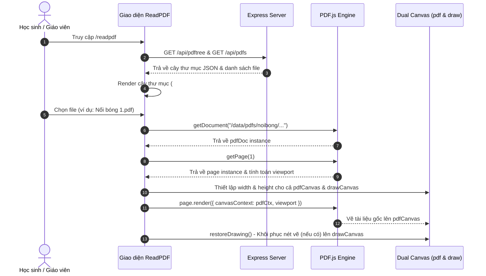
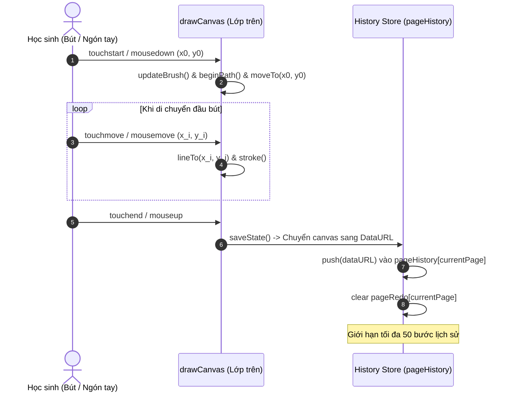

# BẢN ĐẶC TẢ YÊU CẦU PHẦN MỀM (SRS)
## PHÂN HỆ: TRÌNH ĐỌC & CHÚ THÍCH TÀI LIỆU PDF TƯƠNG TÁC
### (INTERACTIVE PDF ANNOTATION & LEARNING WORKSPACE)
**Mã phân hệ**: `APPFLASH-MOD-PDF`  
**Endpoint truy cập**: `/readpdf`  
**APIs liên quan**: `GET /api/pdftree`, `GET /api/pdfs`, `/data/pdfs/*`

---

## 1. TỔNG QUAN PHÂN HỆ (MODULE OVERVIEW)

### 1.1. Bối cảnh & Mục tiêu
Trong quá trình giáo dục can thiệp sớm và phát triển tư duy cho trẻ em lứa tuổi mầm non và tiểu học (5–8 tuổi), các bài tập dạng giấy như: **mê cung (maze), tìm điểm khác nhau (spot the differences), nối bóng (shadow matching), tách gộp số, quy luật logic, luyện trí nhớ** đóng vai trò tối quan trọng.

Phân hệ **Trình đọc & chú thích PDF tương tác** (`/readpdf`) được thiết kế nhằm số hóa trải nghiệm làm bài tập trên giấy truyền thống thành môi trường tương tác trực quan trên thiết bị số (iPad, máy tính bảng, màn hình cảm ứng, PC). Hệ thống kết hợp khả năng dựng tài liệu định dạng chuẩn PDF với công nghệ vẽ tương tác thời gian thực hai lớp (Dual-Layer Canvas), cho phép học sinh:
- Tự do khoanh tròn, nối hình, tô màu, vẽ đường đi trong mê cung, viết số trực tiếp lên trang sách.
- Sử dụng bút dạ quang để làm nổi bật thông tin hoặc tẩy xóa khi làm sai mà không ảnh hưởng đến nội dung sách gốc.
- Quản lý và duyệt toàn bộ thư viện học liệu thông qua cây thư mục trực quan.

### 1.2. Phạm vi phân hệ
- **Duyệt và nạp tài liệu**: Duyệt phân cấp học liệu dạng cây, nạp file từ máy chủ hoặc tải file từ máy cục bộ.
- **Render PDF độ nét cao**: Dựng trang PDF với khả năng phóng to/thu nhỏ (Zoom) và xoay trang (Rotate) linh hoạt.
- **Bộ công cụ chú thích đồ họa (Annotation Toolkit)**: Bút vẽ mực (Pen), bút dạ quang trong suốt (Highlighter/Marker), tẩy xóa pixel (Eraser), bảng màu 10+ sắc thái, slider chỉnh cỡ nét.
- **Quản lý trạng thái đa tầng (State Management)**: Quản lý lịch sử Undo/Redo độc lập theo từng trang (Per-page history) và lưu trữ tự động vết vẽ khi chuyển qua lại giữa các trang.
- **Tối ưu hóa thao tác cảm ứng**: Hỗ trợ chuẩn Pointer/Touch events, khóa cuộn trang khi vẽ, giao diện công cụ bố trí hai bên thân thiện với trẻ nhỏ.

---

## 2. KIẾN TRÚC KỸ THUẬT CHI TIẾT (TECHNICAL ARCHITECTURE)

```
+----------------------------------------------------------------------------------------------------+
|                                         TRÌNH DUYỆT (CLIENT)                                       |
|                                                                                                    |
|  +--------------------+     +-----------------------------------------+     +-------------------+  |
|  |   TOOLBAR TRÁI     |     |          VÙNG HIỂN THỊ CHÍNH            |     |   TOOLBAR PHẢI    |  |
|  | - PDF File Picker  |     |               (#viewer)                 |     | - Xoay (Rotate)   |  |
|  | - PDF Combobox     |     |  +-----------------------------------+  |     | - Hoàn tác (Undo) |  |
|  | - Cây thư mục PDF  |     |  | Lớp 2: drawCanvas (Transparent)   |  |     | - Làm lại (Redo)  |  |
|  | - Zoom In / Out    | ──► |  |  * Nhận sự kiện Touch/Mouse       |  | ◄── | - Tẩy xóa (Eraser)|  |
|  | - Chỉ báo Zoom %   |     |  |  * Vẽ nét, Marker, Eraser         |  |     | - Xóa trang (Del) |  |
|  | - Bảng màu & Size  |     |  +-----------------------------------+  |     | - Bút vẽ (Pen)    |  |
|  +--------------------+     |  | Lớp 1: pdfCanvas (Rendered Page)  |  |     | - Dạ quang (Marker|  |
|                             |  |  * PDF.js Context                 |  |     | - Chuyển trang    |  |
|                             |  +-----------------------------------+  |     | - Bảng màu phụ    |  |
|                             +-----------------------------------------+     +-------------------+  |
|                                                  ▲                                                 |
|                                                  │ Viewport Transform / Sync                       |
|                                     +-------------------------+                                    |
|                                     |    Engine State Store   |                                    |
|                                     | - pageHistory[page]     |                                    |
|                                     | - pageRedo[page]        |                                    |
|                                     | - drawings[page]        |                                    |
|                                     +-------------------------+                                    |
+----------------------------------------------------------------------------------------------------+
                                                   ▲
                                                   │ HTTP GET (JSON / Binary stream)
                                                   ▼
+----------------------------------------------------------------------------------------------------+
|                                    MÁY CHỦ BACKEND (Node.js/Express)                               |
|  +------------------------------------+  +------------------------------------------------------+  |
|  | GET /api/pdftree                   |  | GET /api/pdfs                                        |  |
|  | Đệ quy thư mục `data/pdfs`         |  | Quét danh sách phẳng các file .pdf                   |  |
|  | Sinh cấu trúc cây `PdfNode[]`      |  | Phục vụ combobox chọn nhanh                          |  |
|  +------------------------------------+  +------------------------------------------------------+  |
|  +----------------------------------------------------------------------------------------------+  |
|  | Static File Server: `app.use('/data', express.static(...))` & `express.static("data")`       |  |
|  | Phục vụ trực tiếp tài liệu nhị phân PDF (Blob/Stream) tới client                            |  |
|  +----------------------------------------------------------------------------------------------+  |
+----------------------------------------------------------------------------------------------------+
                                                   │
                                                   ▼
+----------------------------------------------------------------------------------------------------+
|                                 KHO HỌC LIỆU `data/pdfs/`                                          |
|  - `4. Mê cung...`   - `noibong/`      - `iq/`          - `Tìm điểm khác nhau...`                  |
|  - `LienTruocSau/`   - `number/`       - `quyluat/`     - `Preschool Worksheets...`                |
|  - `shadowWho/`      - `TachGop10/`    - `timkiem/`     - `trinho/`                                |
+----------------------------------------------------------------------------------------------------+
```

### 2.1. Mô hình Canvas hai lớp (Dual-Layer Canvas Architecture)
Để giải quyết bài toán vẽ chú thích trên tài liệu PDF mà vẫn duy trì chất lượng sắc nét và bảo vệ nguyên vẹn nội dung gốc, phân hệ áp dụng kiến trúc xếp chồng 2 thẻ `<canvas>`:

1. **Lớp hiển thị tài liệu gốc (`#pdfCanvas`)**:
   - Nằm ở tầng dưới (`z-index: 1`).
   - Được kiểm soát độc quyền bởi thư viện `pdfjs-dist` thông qua phương thức `page.render({ canvasContext: pdfCtx, viewport })`.
   - Chỉ được vẽ lại khi có sự kiện chuyển trang, thay đổi mức phóng to/thu nhỏ (Zoom) hoặc xoay góc (Rotation).
   - Nội dung gốc của tài liệu học tập luôn được bảo toàn tuyệt đối, không thể bị xóa hay sửa đổi bởi các thao tác vẽ của người dùng.

2. **Lớp vẽ tương tác (`#drawCanvas`)**:
   - Nằm ở tầng trên (`z-index: 10`), căn vị trí tuyệt đối (`position: absolute; left: 0; top: 0;`).
   - Có kích thước vật lý (width/height pixel) khớp hoàn toàn với `#pdfCanvas`.
   - Nền trong suốt (`transparent`).
   - Nhận toàn bộ sự kiện con trỏ và cử chỉ tay: `mousedown`, `mousemove`, `mouseup`, `touchstart`, `touchmove`, `touchend`.
   - Các nét vẽ được vẽ trực tiếp vào `drawCtx`.

---

## 3. ĐẶC TẢ CHI TIẾT TÍNH NĂNG (DETAILED FUNCTIONAL REQUIREMENTS)

### PHÂN HỆ CHỨC NĂNG 1: DUYỆT & NẠP TÀI NGUYÊN HỌC LIỆU (RESOURCE MANAGEMENT)

#### FR-PDF-01: Cây thư mục học liệu thông minh (`#pdfTree`)
- **Mô tả**: Hiển thị cấu trúc cây thư mục động được nạp từ endpoint `/api/pdftree`.
- **Cơ chế hoạt động**:
  - Tự động gọi API khi khởi tạo trang: `loadPdfTree()`.
  - Hiển thị biểu tượng `📁` cho thư mục và `📄` cho tệp tin PDF.
  - Hỗ trợ thao tác chạm/nhấp vào thư mục để đóng/mở danh sách con (`collapse/expand`).
  - Khi nhấp vào tệp tin PDF (`.tree-file`):
    - Đổi trạng thái highlight thành công (`class="selected"`).
    - Tạo đường dẫn chuẩn `/data/pdfs/${node.relativePath}`.
    - Kích hoạt hàm nạp tài liệu `openPdfUrl(url)`.
- **Cấu trúc phân loại tài liệu hỗ trợ**:
  - `noibong`: Bài tập nối hình bóng vật thể.
  - `4. Mê cung - BIP KIDS`: Bài tập rèn luyện định hướng không gian và đường nét.
  - `Tìm điểm khác nhau`: Bài tập rèn luyện thị giác và khả năng quan sát chi tiết.
  - `iq`: Các câu đố hình học và logic IQ cho trẻ mầm non.
  - `number`, `TachGop10`, `LienTruocSau`: Học liệu toán học mầm non và tiền tiểu học.
  - `shadowWho`, `quyluat`, `timkiem`, `trinho`: Bộ tài liệu phát triển nhận thức toàn diện.

#### FR-PDF-02: Lựa chọn file nhanh qua Combobox (`#pdfSelect`)
- **Mô tả**: Cung cấp danh sách phẳng toàn bộ file PDF thông qua endpoint `/api/pdfs`.
- **Cơ chế hoạt động**:
  - Gọi API `/api/pdfs` khi khởi tạo (`loadPdfList()`).
  - Đổ danh sách vào thẻ `<select id="pdfSelect">` với icon `📚`.
  - Khi người dùng thay đổi giá trị lựa chọn (`change` event), tự động nạp file tương ứng mà không cần duyệt cây.

#### FR-PDF-03: Tải file từ thiết bị cục bộ (`#pdfFile`)
- **Mô tả**: Hỗ trợ phụ huynh hoặc giáo viên đưa các file bài tập PDF tự tạo từ máy tính hoặc iPad vào ứng dụng.
- **Cơ chế hoạt động**:
  - Nhận file qua thẻ `<input type="file" accept=".pdf">`.
  - Đọc dữ liệu dưới dạng `ArrayBuffer` thông qua `file.arrayBuffer()`.
  - Khởi tạo tài liệu bằng PDF.js với tham số nhị phân: `pdfjsLib.getDocument({ data: buffer }).promise`.
  - Tự động đưa về trang 1 và hiển thị ngay trên màn hình.

---

### PHÂN HỆ CHỨC NĂNG 2: BỘ CÔNG CỤ VẼ & CHÚ THÍCH THỜI GIAN THỰC (ANNOTATION ENGINE)

#### FR-PDF-04: Bút vẽ mực tự do (Pen Mode / ✏️)
- **Mô tả**: Công cụ chính dùng để nối từ, vẽ đường mê cung, khoanh tròn đáp án hoặc viết chữ.
- **Thông số kỹ thuật Canvas**:
  - `lineCap = "round"`, `lineJoin = "round"`: Đảm bảo đường vẽ liên tục mượt mà, không gãy khúc.
  - `globalCompositeOperation = "source-over"`: Đè nét vẽ mới lên các nét vẽ cũ.
  - `strokeStyle = brushColor`: Nhận mã màu hex từ bảng màu hiện tại.
  - `lineWidth = brushSize`: Nhận kích thước từ slider (1px – 30px).

#### FR-PDF-05: Bút dạ quang tô sáng (Marker / Highlighter / 🖍️)
- **Mô tả**: Công cụ tô màu nổi bật từ ngữ, dòng chữ hoặc tô nền hình ảnh.
- **Thông số kỹ thuật Canvas**:
  - Thuật toán chuyển đổi màu sang kênh Alpha: `hexToRgba(brushColor, 0.3)`.
  - Độ mờ (opacity) cố định ở mức 30%, cho phép nhìn xuyên thấu toàn bộ văn bản và đường nét của tài liệu PDF bên dưới.
  - Độ dày nét phóng đại gấp 4 lần kích thước bút thường: `lineWidth = brushSize * 4`.
  - Cho phép tô nhiều lớp để tăng độ đậm mà vẫn giữ tính thẩm mỹ giáo dục.

#### FR-PDF-06: Tẩy xóa chọn lọc theo pixel (Eraser Mode / 🧽)
- **Mô tả**: Cho phép học sinh xóa các nét vẽ sai tương tự như dùng gôm tẩy vật lý trên giấy.
- **Thông số kỹ thuật Canvas**:
  - Chế độ hòa trộn: `drawCtx.globalCompositeOperation = "destination-out"`.
  - Cơ chế: Khi di chuyển con trỏ, mọi pixel đã vẽ trên lớp `drawCanvas` tại vùng quét sẽ bị đưa về độ trong suốt 100% (Alpha = 0).
  - Độ dày vùng tẩy: `lineWidth = brushSize * 2`.
  - **Tính bất biến**: Hoàn toàn không tác động đến lớp `#pdfCanvas`, đảm bảo tài liệu sách không bao giờ bị xóa nhầm.

#### FR-PDF-07: Xóa sạch toàn bộ nét vẽ của trang (Clear Page / 🗑️)
- **Mô tả**: Nút bấm làm sạch nhanh trang bài tập để học sinh có thể làm lại từ đầu.
- **Cơ chế hoạt động**:
  - Kích hoạt `drawCtx.clearRect(0, 0, drawCanvas.width, drawCanvas.height)`.
  - Gán trạng thái vẽ của trang hiện tại về rỗng: `drawings[currentPage] = null`.
  - Đẩy trạng thái trắng vào ngăn xếp lịch sử: `pageHistory[currentPage] = [drawCanvas.toDataURL()]`.
  - Xóa sạch ngăn xếp redo của trang: `pageRedo[currentPage] = []`.

#### FR-PDF-08: Tùy biến bảng màu & Kích cỡ nét vẽ
- **Bảng màu trực quan (Color Palette)**:
  - Bố trí dạng lưới 2 cột tại cả 2 thanh công cụ trái và phải.
  - 10 màu cơ bản thân thiện: Đen (`#000000`), Đỏ (`#ff0000`), Cam (`#ff9900`), Vàng (`#ffff00`), Xanh lá (`#00cc00`), Xanh lơ (`#00a2e8`), Xanh tím (`#3f48cc`), Tím (`#a349a4`), Trắng (`#ffffff`), Xám (`#cccccc`).
  - Hiệu ứng thị giác: Viền highlight xanh dương đậm và shadow nổi bật khi một màu được chọn (`.color-item.active`).
- **Thanh trượt kích cỡ nét (Size Picker)**:
  - Dải giá trị từ 1px đến 30px (`min="1" max="30" value="5"`).
  - Hiển thị trực quan chỉ số pixel ngay dưới thanh trượt (`#sizeValue`).

---

### PHÂN HỆ CHỨC NĂNG 3: QUẢN LÝ LỊCH SỬ & LƯU TRỮ VẾT VẼ (STATE & PERSISTENCE)

#### FR-PDF-09: Hoàn tác (Undo / ↩️) & Làm lại (Redo / ↪️) theo từng trang
- **Mô tả**: Cơ chế quản lý ngăn xếp lịch sử độc lập cho từng trang tài liệu, tránh xung đột trạng thái khi học sinh lật giữa nhiều trang khác nhau.
- **Cấu trúc dữ liệu**:
  - `pageHistory = { [pageNumber: number]: string[] }`: Mảng chứa chuỗi base64 `dataURL` của từng bước vẽ.
  - `pageRedo = { [pageNumber: number]: string[] }`: Mảng chứa các bước đã hoàn tác để phục hồi khi cần.
  - Giới hạn bộ nhớ: Tối đa 50 bước lịch sử cho mỗi trang (`max 50 states`). Khi vượt quá, hệ thống tự động loại bỏ bước cũ nhất (`pageHistory[page].shift()`).
- **Quy trình Undo**:
  1. Kiểm tra độ dài `pageHistory[currentPage] > 1`.
  2. Lấy trạng thái hiện tại (`pop()`) và đẩy vào `pageRedo[currentPage]`.
  3. Lấy trạng thái liền trước và phục hồi lên Canvas bằng hàm `restoreCanvas()`.
- **Quy trình Redo**:
  1. Kiểm tra `pageRedo[currentPage].length > 0`.
  2. Lấy trạng thái từ redo stack (`pop()`) và đẩy ngược lại vào `pageHistory[currentPage]`.
  3. Phục hồi trạng thái vừa lấy lên canvas.

#### FR-PDF-10: Tự động lưu và khôi phục vết vẽ khi chuyển trang
- **Mô tả**: Khi người dùng lật sang trang mới, mọi nét vẽ ở trang hiện tại không bị mất đi mà được ghi nhớ tự động.
- **Cơ chế hoạt động**:
  - Trước khi render trang mới: Hàm `saveDrawing()` tự động trích xuất canvas hiện tại thành chuỗi ảnh: `drawings[currentPage] = drawCanvas.toDataURL()`.
  - Sau khi trang PDF mới render hoàn tất: Hàm `restoreDrawing()` kiểm tra xem trang đó đã có dữ liệu trong `drawings[newPage]` hay chưa:
    - Nếu có: Tải ảnh base64 và vẽ lại hoàn chỉnh lên `drawCanvas` qua `drawImage()`.
    - Nếu chưa có: Làm sạch `drawCanvas` và khởi tạo lịch sử trang mới.

---

### PHÂN HỆ CHỨC NĂNG 4: ĐIỀU KHIỂN KHÔNG GIAN HIỂN THỊ (VIEWPORT & NAVIGATION)

#### FR-PDF-11: Phóng to / Thu nhỏ đa cấp độ (Zoom In / Out)
- **Mô tả**: Giúp trẻ em phóng to các chi tiết nhỏ trong bài toán mê cung hoặc tranh tìm điểm khác nhau.
- **Thông số kỹ thuật**:
  - Mức zoom tối thiểu (`MIN_ZOOM`): `0.1` (10%).
  - Mức zoom tối đa (`MAX_ZOOM`): `5.0` (500%).
  - Bước nhảy (`ZOOM_STEP`): `0.05` (5% mỗi lần bấm).
  - Tự động căn chỉnh kích thước vùng chứa:
    ```javascript
    const fitScale = containerWidth / originalViewport.width;
    const viewport = page.getViewport({ scale: fitScale * zoomLevel, rotation });
    ```
  - Cập nhật chỉ số phần trăm thời gian thực lên nhãn `#zoomValue`.

#### FR-PDF-12: Xoay trang tài liệu 360 độ (Rotate / 🔄)
- **Mô tả**: Hỗ trợ xoay các tài liệu scan bị ngược chiều hoặc xoay ngang để phù hợp với hướng cầm iPad.
- **Cơ chế hoạt động**:
  - Mỗi lần nhấp nút `#rotateBtn`, góc xoay tăng thêm 90 độ (`rotation = (rotation + 90) % 360`).
  - Tự động tính toán lại kích thước khung hình viewport và render lại cả 2 lớp canvas tương ứng với hướng xoay mới.

#### FR-PDF-13: Điều hướng trang tài liệu (Pagination Controls)
- **Mô tả**: Chuyển đổi giữa các trang trong tập tài liệu PDF nhiều trang.
- **Điều khiển**:
  - Nút lùi trang (`#prevBtn / ⬅️`): Giảm `currentPage`, chặn khi ở trang 1.
  - Nút tiến trang (`#nextBtn / ➡️`): Tăng `currentPage`, chặn khi ở trang cuối `numPages`.
  - Bộ hiển thị trang hiện tại và tổng số trang: `Trang <span id="pageNum"></span> / <span id="pageCount"></span>`.
  - Hỗ trợ hạ tầng cử chỉ vuốt ngang cảm ứng (Swipe Left/Right với ngưỡng `SWIPE_THRESHOLD = 80px`).

---

### PHÂN HỆ CHỨC NĂNG 5: TƯƠNG TÁCH CẢM ỨNG & THIẾT KẾ ĐA THIẾT BỊ (TOUCH & UI DESIGN)

#### FR-PDF-14: Xử lý sự kiện cảm ứng chuyên sâu (Touch Handling)
- Hỗ trợ đồng thời 2 tập sự kiện:
  - **Desktop/Mouse**: `mousedown`, `mousemove`, `mouseup`.
  - **Mobile/Tablet/Touch**: `touchstart`, `touchmove`, `touchend`.
- **Thuật toán ánh xạ tọa độ chính xác**:
  ```javascript
  function getPos(e) {
    const rect = drawCanvas.getBoundingClientRect();
    return {
      x: e.clientX - rect.left,
      y: e.clientY - rect.top
    };
  }
  ```
  Sử dụng `getBoundingClientRect()` để đảm bảo tọa độ đầu bút vẽ luôn trùng khớp 100% với vị trí ngón tay hoặc bút cảm ứng (Apple Pencil / Stylus) kể cả khi trang đang bị co giãn hoặc cuộn.
- **Ngăn chặn xung đột cảm ứng**: Gọi `e.preventDefault()` trong `touchstart` và `touchmove` để ngăn chặn hành vi cuộn trang mặc định của trình duyệt khi đang thao tác vẽ bài tập.

#### FR-PDF-15: Bố cục thanh công cụ công thái học (Dual Sidebars)
- **Thanh công cụ trái (`.toolbar-left`)**: Bố trí các công cụ quản trị và lựa chọn: nạp file, cây thư mục, nút zoom in/out, bảng màu cơ bản, thanh chỉnh độ dày nét.
- **Thanh công cụ phải (`.toolbar-right`)**: Bố trí các công cụ thao tác nhanh: xoay trang, hoàn tác, làm lại, bút mực, bút dạ quang, tẩy, xóa trang, chuyển trang tới/lui.
- **Tối ưu hóa tầm với**: Cho phép người học dùng cả hai tay khi cầm máy tính bảng (tay trái chọn màu/zoom, tay phải chuyển công cụ/vẽ).

---

## 4. ĐẶC TẢ GIAO DIỆN LẬP TRÌNH BACKEND (BACKEND API SPECIFICATION)

### 4.1. `GET /api/pdftree`
- **Chức năng**: Quét đệ quy cây thư mục `data/pdfs/` và trả về cấu trúc phân cấp dạng cây JSON để hiển thị widget file explorer.
- **Logic Backend**:
  ```typescript
  interface PdfNode {
    type: "folder" | "file";
    name: string;
    path?: string;
    relativePath?: string;
    children?: PdfNode[];
  }
  ```
- **Ví dụ kết quả trả về**:
  ```json
  [
    {
      "type": "folder",
      "name": "noibong",
      "children": [
        {
          "type": "file",
          "name": "Nối bóng 1 - BIP KIDS- Lã Thu Hà ( Mẹ Bíp).pdf",
          "relativePath": "noibong/Nối bóng 1 - BIP KIDS- Lã Thu Hà ( Mẹ Bíp).pdf"
        }
      ]
    },
    {
      "type": "folder",
      "name": "4. Mê cung - BIP KIDS - Lã Thu Hà ( Mẹ Bíp)",
      "children": [
        {
          "type": "file",
          "name": "Mê cung động vật.pdf",
          "relativePath": "4. Mê cung - BIP KIDS - Lã Thu Hà ( Mẹ Bíp)/Mê cung động vật.pdf"
        }
      ]
    },
    {
      "type": "file",
      "name": "Preschool Worksheets PDF Book.pdf",
      "relativePath": "Preschool Worksheets PDF Book.pdf"
    }
  ]
  ```

### 4.2. `GET /api/pdfs`
- **Chức năng**: Quét đệ quy toàn bộ thư mục `data/pdfs/` và trả về danh sách phẳng các đường dẫn tương đối tới mọi file `.pdf`.
- **Ví dụ kết quả trả về**:
  ```json
  [
    "noibong/Nối bóng 1 - BIP KIDS- Lã Thu Hà ( Mẹ Bíp).pdf",
    "Preschool Worksheets PDF Book.pdf",
    "Tìm điểm khác nhau.pdf"
  ]
  ```

### 4.3. `GET /data/pdfs/*` & `GET /pdfs/*`
- **Chức năng**: Cung cấp nội dung nhị phân (Binary Stream / Content-Type: `application/pdf`) cho trình duyệt để nạp vào PDF.js.

---

## 5. SƠ ĐỒ LUỒNG DỮ LIỆU & TƯƠNG TÁC (PROCESS FLOWS)

### 5.1. Luồng nạp tài liệu và khởi tạo Canvas


### 5.2. Luồng thao tác vẽ và Quản lý Lịch sử Undo/Redo


---

## 6. YÊU CẦU PHI CHỨC NĂNG (NON-FUNCTIONAL REQUIREMENTS)

### 6.1. Hiệu năng & Trải nghiệm vẽ thời gian thực (Realtime Responsiveness)
- **Độ trễ vẽ nét (Stroke Latency)**: Tốc độ phản hồi từ lúc ngón tay/bút chạm vào màn hình đến khi pixel xuất hiện trên canvas phải đạt mức **< 16ms** (đạt tần số quét 60 FPS tiêu chuẩn).
- **Tối ưu hóa bộ nhớ ảnh**: Sử dụng nén PNG trong `toDataURL()`; kiểm soát dung lượng bộ nhớ `pageHistory` tối đa 50 phần tử để tránh tràn RAM trên các thiết bị iPad đời cũ.

### 6.2. Tính tương thích thiết bị (Device Compatibility)
- Hoạt động ổn định trên các nền tảng trình duyệt hiện đại: Safari (iOS/iPadOS), Chrome (Android, Windows, macOS), Edge, Firefox.
- Hỗ trợ tốt tỷ lệ màn hình 4:3 (chuẩn iPad) và 16:9/16:10 (máy tính bảng Android và laptop cảm ứng).

### 6.3. Tính khả dụng sư phạm (Pedagogical Usability)
- Thiết kế nút bấm kích thước lớn (tối thiểu 44px x 44px trên mobile/tablet, font size 20px - 35px) giúp trẻ em dễ dàng thao tác bấm mà không sợ trượt.
- Màu sắc trực quan, biểu tượng Emoji sinh động (`✏️`, `🖍️`, `🧽`, `🗑️`, `🔄`, `📁`, `📄`) giúp trẻ nhận biết công cụ ngay cả khi chưa thành thạo chữ viết.

### 6.4. Bảo toàn tính toàn vẹn tài liệu (Data Integrity)
- Không bao giờ cho phép các thao tác tẩy xóa hay vẽ đè làm biến dạng hoặc mất mát file PDF gốc trên máy chủ.
- Mọi dữ liệu chú thích được lưu trữ độc lập trên RAM trình duyệt ở tầng client.

---

## 7. KẾ HOẠCH NÂNG CẤP & MỞ RỘNG (FUTURE ENHANCEMENTS)

1. **Xuất và In ấn bài tập có chú thích (Export Annotated PDF)**:
   - Sử dụng thư viện `pdf-lib` hoặc `jspdf` để ghép lớp `drawCanvas` trực tiếp vào tài liệu PDF và cho phép tải về (`Download Result`) hoặc in ấn ra giấy (`Print`).
2. **Lưu trữ đám mây hoặc LocalStorage cho vết vẽ**:
   - Tự động lưu tiến độ làm bài vào `IndexedDB` hoặc cơ sở dữ liệu SQLite máy chủ (`agent.db`), giúp học sinh có thể tiếp tục làm bài tập dang dở ở các buổi học sau.
3. **Thêm công cụ hình học & Nhãn dán thưởng (Stickers & Shapes)**:
   - Thêm công cụ vẽ đường thẳng thước kẻ, hình tròn, hình chữ nhật cho bài tập nối hình.
   - Thêm sticker ngôi sao điểm 10 (`⭐`, `💯`, `🌸`) để giáo viên hoặc phụ huynh chấm điểm bài làm của trẻ ngay trên màn hình.
4. **AI Tự động nhận diện nét vẽ và chấm bài**:
   - Ứng dụng Vision AI (Gemini Vision) để tự động kiểm tra xem trẻ đã hoàn thành đường mê cung hay tìm đủ số lượng điểm khác nhau giữa 2 bức tranh hay chưa.

