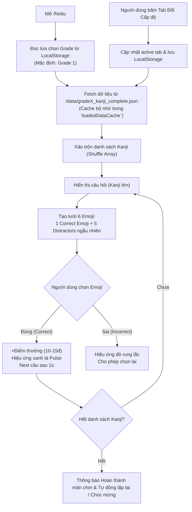

# Đặc tả Kỹ thuật `src/Noitu.html` & Kế hoạch Nâng cấp Dữ liệu Kanji 3 Cấp độ (Grade 1, 2, 3)

Tài liệu này cung cấp **đặc tả chi tiết (Specification)** của trò chơi "Nối từ" (*かんじを つなごう！* - Nối chữ Hán với Emoji) hiện có trong [`src/Noitu.html`](file:///d:/workspaces/AI/APPFLASH/src/Noitu.html), đồng thời đưa ra **kế hoạch chuyển đổi toàn diện** sang sử dụng kho dữ liệu chuẩn hơn 470 chữ Kanji từ 3 cấp độ tiểu học (Lớp 1, Lớp 2, Lớp 3), cho phép người học tùy chọn từng cấp độ hoặc trộn lẫn cả 3 cấp độ.

---

## 1. Đặc tả Chi tiết Trò chơi `src/Noitu.html` Hiện tại (Current Specification)

### 1.1. Mục tiêu & Vòng lặp Gameplay (Gameplay Loop)
- **Tên trò chơi**: かんじを つなごう！ (*Kanji wo Tsunagou! - Hãy nối chữ Hán!*). Trong menu chính [`src/base.html`](file:///d:/workspaces/AI/APPFLASH/src/base.html) trò chơi được gọi là **Tìm Từ**.
- **Đối tượng**: Học sinh tiểu học / người mới bắt đầu học tiếng Nhật.
- **Mục tiêu**: Người chơi nhìn chữ Kanji lớn hiển thị ở giữa màn hình, sau đó chọn đúng biểu tượng Emoji tương ứng với ý nghĩa của chữ Kanji đó trong 6 lựa chọn Emoji được xáo trộn.

```
+-------------------------------------------------------------------+
|                     かんじを つなごう！                           |
|  [ 点数: 15 ]                                [ レベル: 1 ]       |
+-------------------------------------------------------------------+
|                                                                   |
|                              犬                                   |  <- Chữ Kanji hiển thị lớn
|                                                                   |
+-------------------------------------------------------------------+
|          [ ひらがな: いぬ / 意味 / 例文 ] (Vùng gợi ý)            |
|                   [ ヒントを見る (3回) ]                          |
+-------------------------------------------------------------------+
|    +---------+     +---------+     +---------+                    |
|    |   🐱    |     |   🐶    |     |   🚗    |                    |
|    +---------+     +---------+     +---------+                    |  <- Lưới 6 Emoji lựa chọn
|    +---------+     +---------+     +---------+                    |
|    |   🍎    |     |   🌊    |     |   🌳    |                    |
|    +---------+     +---------+     +---------+                    |
+-------------------------------------------------------------------+
|              [====================== 40% =====================]    |  <- Thanh tiến độ
|  [ 🔓 初心者 ]  [ 🔒 中級者 ]  [ 🔒 上級者 ]  [ 🔒 達人 ]        |  <- Huy hiệu thành tựu
+-------------------------------------------------------------------+
```

### 1.2. Các thành phần Giao diện (UI Components)
1. **Thanh thông tin trò chơi (`.game-info`)**:
   - `点数 (Score)`: Điểm số tích lũy hiện tại (khởi đầu = `0`).
   - `レベル (Level)`: Cấp độ hiện tại (hiện tại hiển thị `1`, `2`, `3`).
2. **Khu vực hiển thị Kanji (`#kanji`)**:
   - Chữ Kanji hiển thị nổi bật với kích thước cực lớn (`5rem` trên máy tính, `3.5rem` trên di động).
3. **Khu vực Gợi ý (`.hint-container`) & Nút gợi ý (`#hintButton`)**:
   - Mỗi câu hỏi người chơi có tối đa **3 lần xem gợi ý**:
     - *Lần 1*: Hiển thị cách đọc Hiragana (`ひらがな: いぬ`).
     - *Lần 2*: Hiển thị nghĩa của từ (`漢字の意味: 犬`).
     - *Lần 3*: Hiển thị câu ví dụ chứa từ đó (`例文: 犬が走っている`).
   - Khi hết 3 lần, nút chuyển sang trạng thái disabled: *"ヒントを使いました"*.
4. **Lưới Emoji lựa chọn (`#emojiContainer`)**:
   - Lưới 6 ô (grid 3 cột x 2 hàng trên desktop, 2 cột x 3 hàng trên mobile).
   - Gồm **1 Emoji đúng** và **5 Emoji sai** được lấy ngẫu nhiên và xáo trộn vị trí (`shuffleArray`).
   - Kích thước font icon Emoji lớn (`7rem`), hiệu ứng hover nhô cao và bóng đổ.
5. **Thông báo kết quả (`#message`)**:
   - **Đúng**: Viền/nền ô đổi màu xanh lá (`#90ee90`), hiệu ứng phóng to `pulse`, thông báo xanh *"正解！"*. Sau 1 giây tự động chuyển câu hỏi tiếp theo.
   - **Sai**: Ô đổi màu đỏ (`#ff6b6b`), thông báo đỏ *"不正解！もう一度挑戦してください"*. Sau 1 giây tự động phục hồi để người chơi bấm lại.
6. **Thanh tiến độ (`#progress`)**:
   - Tỷ lệ hoàn thành theo số câu hỏi trong level: `(currentKanjiIndex / kanjiData.length) * 100%`.
7. **Hệ thống Thành tựu (`#achievements`)**:
   - Tự động mở khóa huy hiệu theo mốc điểm:
     - `初心者` (Người mới): 100 điểm.
     - `中級者` (Trung cấp): 500 điểm.
     - `上級者` (Cao cấp): 1000 điểm.
     - `達人` (Bậc thầy): 2000 điểm.

### 1.3. Cơ chế Tính điểm (Scoring Engine)
- Trả lời đúng nhận **10 điểm cơ bản**.
- Điểm thưởng nếu không dùng gợi ý:
  - Dùng 0 gợi ý: Thưởng **+5 điểm** (Tổng: 15 điểm).
  - Dùng 1 gợi ý: Thưởng **+3 điểm** (Tổng: 13 điểm).
  - Dùng 2 gợi ý: Thưởng **+1 điểm** (Tổng: 11 điểm).
  - Dùng cả 3 gợi ý: Nhận **10 điểm**.

### 1.4. Nguồn Dữ liệu Hiện tại & Hạn chế Cần Khắc phục
- **Dữ liệu hiện tại bị hardcode thủ công trong script**:
  - Mảng `levels` gồm 3 level, mỗi level chỉ có **10 từ vựng** (tổng cộng chỉ có vỏn vẹn **30 từ vựng**).
  - Từ điển tra cứu nghĩa `getMeaning()` và câu ví dụ `getExample()` được viết thủ công bằng switch/dictionary tĩnh ngay trong code JS.
- **Hạn chế**:
  - Không có bộ chọn cấp độ lớp học (Grade 1, 2, 3) theo chuẩn Bộ Giáo dục Nhật Bản (MEXT).
  - Số lượng câu hỏi quá ít (chỉ 30 câu), chơi một lát là lặp lại toàn bộ.
  - Từ điển ví dụ viết cứng, không thể mở rộng và khó bảo trì.
  - Chưa có nút "Quay lại Menu" (`Back to Menu`) dẫn về trang chủ ứng dụng.

---

## 2. Kế hoạch Chuyển đổi Dữ liệu sang Grade 1, Grade 2, Grade 3

### 2.1. Phân tích 3 Tệp Dữ liệu Nguồn
Cả 3 tệp dữ liệu đã có sẵn trong thư mục `data/` với tổng cộng **470 chữ Kanji**:

| Tệp dữ liệu | Cấp độ | Số lượng Kanji | Nội dung tiêu biểu |
| :--- | :---: | :---: | :--- |
| [`data/grade1_kanji_complete.json`](file:///d:/workspaces/AI/APPFLASH/data/grade1_kanji_complete.json) | Lớp 1 (Grade 1) | **80 Kanji** | 一, 右, 雨, 円, 王, 音, 下, 火, 花, 犬, 口, 山, 水... |
| [`data/grade2_kanji_complete.json`](file:///d:/workspaces/AI/APPFLASH/data/grade2_kanji_complete.json) | Lớp 2 (Grade 2) | **190 Kanji** | 引, 羽, 雲, 園, 遠, 何, 科, 夏, 家, 歌, 画, 海, 絵... |
| [`data/grade3_kanji_complete.json`](file:///d:/workspaces/AI/APPFLASH/data/grade3_kanji_complete.json) | Lớp 3 (Grade 3) | **200 Kanji** | 悪, 安, 暗, 医, 委, 意, 育, 員, 院, 飲, 運, 泳, 駅... |
| **Tổng cộng** | **Cả 3 lớp** | **470 Kanji** | Toàn bộ chữ Kanji cơ bản bậc tiểu học |

#### Cấu trúc trường chuẩn của mỗi bản ghi:
```json
{
  "id": "1",
  "kanji": "悪",
  "read": "わるい",
  "onyomi": ["アク", "オ"],
  "kunyomi": ["わるい"],
  "emoji": "😈",
  "meaning_vi": "xấu",
  "description": "Điều không tốt hoặc không đúng.",
  "example": "悪いことをしない。",
  "example_read": "わるい こと を しない。",
  "example_vi": "Không làm điều xấu.",
  "difficulty": 3,
  "grade": 3
}
```
> [!TIP]
> 100% trong số 470 bản ghi đều đã có sẵn `emoji` minh họa, `read` (âm đọc Hiragana), `meaning_vi` (nghĩa tiếng Việt), `description` (giải thích), `example` (câu ví dụ tiếng Nhật) và `example_read` (cách đọc ví dụ).

---

### 2.2. Thiết kế Bộ chọn Cấp độ (Grade Mode Selector)

Ngay phía dưới tiêu đề trò chơi, ta sẽ bổ sung thanh chọn cấp độ (Segmented Tabs) thân thiện với trẻ em:

```
[ 🏠 Trang chủ ]
<h1>かんじを つなごう！</h1>

+------------------------------------------------------------------------+
|  [ 🌸 Lớp 1 (80 từ) ]  [ 🌿 Lớp 2 (190 từ) ]  [ 🍁 Lớp 3 (200 từ) ]  [ 🎲 Trộn cả 3 (470 từ) ]  |
+------------------------------------------------------------------------+
```

1. **4 Chế độ lựa chọn**:
   - **Lớp 1 (`grade1`)**: Nạp 80 chữ Kanji lớp 1. Thích hợp cho người mới bắt đầu.
   - **Lớp 2 (`grade2`)**: Nạp 190 chữ Kanji lớp 2. Thử thách nâng cao.
   - **Lớp 3 (`grade3`)**: Nạp 200 chữ Kanji lớp 3. Trình độ nâng cao.
   - **Trộn cả 3 (`all` / `mixed`)**: Gộp toàn bộ 470 chữ Kanji từ cả 3 lớp và xáo trộn ngẫu nhiên.
2. **Ghi nhớ trạng thái (`localStorage`)**:
   - Lưu lựa chọn gần nhất (`noitu_selected_grade`) để khi người học vào lại trang, game tự động giữ nguyên cấp độ đã chọn.
3. **Hiển thị thông số linh hoạt**:
   - Hiển thị tổng số câu hỏi tương ứng theo chế độ: `Câu hỏi X / 80`, `X / 190` hoặc `X / 470`.

---

### 2.3. Tự động hóa Hệ thống Gợi ý (Zero Hardcoding)

Thay vì dùng dictionary tĩnh như hiện tại, hàm `showHint()` sẽ đọc trực tiếp từ đối tượng câu hỏi hiện tại:
- **Hint 1 (Cách đọc Hiragana)**:
  `ひらがな: ${currentKanji.read}`
- **Hint 2 (Ý nghĩa tiếng Việt & Giải nghĩa)**:
  `意味: ${currentKanji.meaning_vi}${currentKanji.description ? ' (' + currentKanji.description + ')' : ''}`
- **Hint 3 (Câu ví dụ minh họa & Phiên âm)**:
  `例文: ${currentKanji.example}`
  *(Bổ sung cách đọc Hiragana của câu ví dụ: `currentKanji.example_read`)*

---

### 2.4. Thuật toán Sinh Lưới 6 Emoji Độc nhất (Unique Distractors)

Để tránh tình trạng trùng lặp emoji trong lưới 6 ô:
1. Lấy `correctEmoji = currentKanji.emoji`.
2. Tạo danh sách tất cả các emoji hợp lệ từ tập dữ liệu đang chơi:
   `pool = allUniqueEmojisFromCurrentGrade.filter(e => e !== correctEmoji)`.
3. Xáo trộn ngẫu nhiên mảng `pool` và lấy ra **5 emoji khác nhau**.
4. Ghép `[correctEmoji, ...5Distractors]` thành 6 emoji và xáo trộn lại một lần nữa trước khi hiển thị.

---

### 2.5. Bổ sung Nút Điều hướng (Back to Home) & Nâng cấp Lucide Icons

- Bổ sung nút quay lại góc trên bên trái:
  `<a href="/" class="back-home-btn"><i data-lucide="arrow-left"></i> Menu chính</a>`
- Tích hợp bộ icon Lucide offline ([`src/js/lucide.min.js`](file:///d:/workspaces/AI/APPFLASH/src/js/lucide.min.js)):
  - Icon quay lại: `arrow-left`
  - Icon gợi ý: `help-circle` hoặc `lightbulb`
  - Icon điểm số: `trophy` / `award`
  - Icon cấp độ: `graduation-cap` / `layers`

---

## 3. Kiến trúc Kỹ thuật & Luồng Dữ liệu (Architecture)



---

## 4. Kế hoạch Triển khai Chi tiết

| Bước | Nội dung công việc | Mục tiêu cụ thể |
| :---: | :--- | :--- |
| **1** | **Xây dựng Giao diện Cấp độ & Điều hướng** | - Thêm nút "Menu chính" (`Back to Menu`).<br/>- Thêm thanh chọn cấp độ (Grade Tabs: Lớp 1, Lớp 2, Lớp 3, Trộn cả 3).<br/>- Thêm liên kết `/js/lucide.min.js` để render vector icons. |
| **2** | **Xây dựng Trình nạp Dữ liệu Bất đồng bộ (`loadGradeData`)** | - Tải các tệp `/data/grade1_kanji_complete.json`, `grade2...`, `grade3...` qua `fetch()`.<br/>- Xây dựng bộ nhớ đệm `dataCache` để tránh fetch nhiều lần.<br/>- Xử lý chế độ trộn (`all`): Gộp cả 3 tệp thành mảng 470 từ. |
| **3** | **Cập nhật Vòng lặp Game & Bộ sinh câu hỏi** | - Thay thế dữ liệu hardcode bằng danh sách nạp từ JSON.<br/>- Đảm bảo 6 Emoji luôn độc nhất (1 đáp án đúng + 5 emoji khác biệt).<br/>- Cập nhật số đếm tiến độ: `X / Tổng số từ`. |
| **4** | **Nâng cấp Hệ thống Gợi ý (3 Hints) động** | - Xóa bỏ 2 dictionary tĩnh `getMeaning` và `getExample`.<br/>- Sử dụng trực tiếp `read`, `meaning_vi`, `example` và `example_read` từ JSON. |
| **5** | **CSS Styling & Responsive hoàn thiện** | - Tạo kiểu dáng hiện đại cho thanh chọn lớp học (Grade Tabs).<br/>- Đảm bảo giao diện mượt mà trên iPad, tablet và điện thoại. |
| **6** | **Kiểm thử Toàn diện & Typecheck** | - Test từng tab cấp độ (1, 2, 3 và Trộn cả 3).<br/>- Kiểm tra chạy offline không phụ thuộc CDN.<br/>- Chạy `npm run typecheck` xác nhận không có lỗi. |

---

## 5. Tiêu chuẩn Chấp nhận & Kế hoạch Kiểm thử

1. **Kiểm tra chọn cấp độ**:
   - Bấm **Lớp 1**: Tiến độ hiển thị theo 80 từ; chỉ xuất hiện chữ Kanji lớp 1.
   - Bấm **Lớp 2**: Tiến độ hiển thị theo 190 từ; xuất hiện chữ Kanji lớp 2.
   - Bấm **Lớp 3**: Tiến độ hiển thị theo 200 từ; xuất hiện chữ Kanji lớp 3.
   - Bấm **Trộn cả 3**: Danh sách mở rộng lên 470 từ, xáo trộn ngẫu nhiên từ cả 3 lớp.
2. **Kiểm tra độ chính xác của Emoji**:
   - Mỗi câu hỏi hiển thị đúng Emoji định nghĩa trong JSON.
   - 5 Emoji còn lại không bị trùng với Emoji đáp án và không trùng nhau.
3. **Kiểm tra tính năng Gợi ý**:
   - Hint 1: Hiển thị đúng âm Hiragana của chữ.
   - Hint 2: Hiển thị đúng nghĩa tiếng Việt.
   - Hint 3: Hiển thị câu ví dụ tiếng Nhật và phiên âm.
4. **Kiểm tra lưu trạng thái**:
   - Chọn Lớp 2, reload trang (F5): Trang tự động mở lại Lớp 2.
5. **Kiểm tra điều hướng**:
   - Bấm nút "Menu chính" quay về trang chủ `/` mượt mà.

---
Bạn vui lòng xem lại bản đặc tả và kế hoạch nâng cấp trên, sau đó bấm nút **Proceed** (hoặc để lại phản hồi) để tôi bắt đầu thực hiện!
